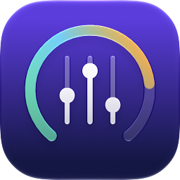
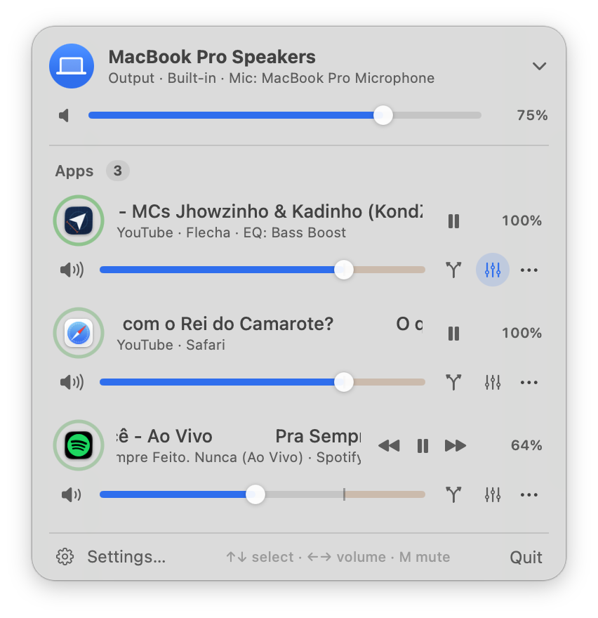
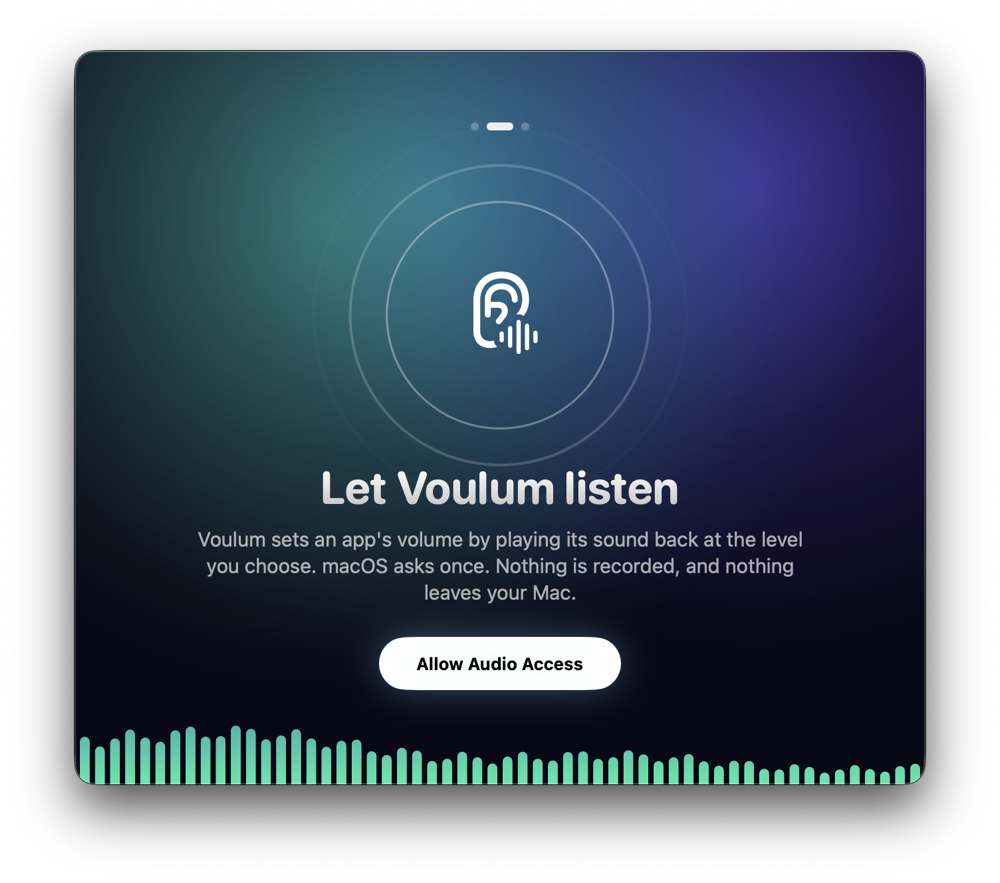
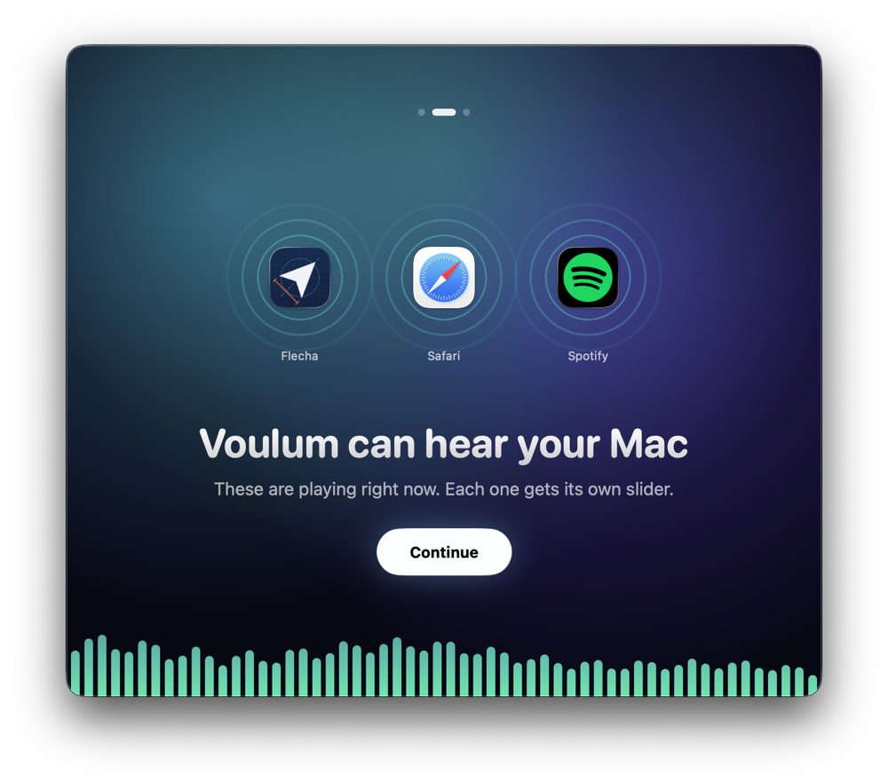
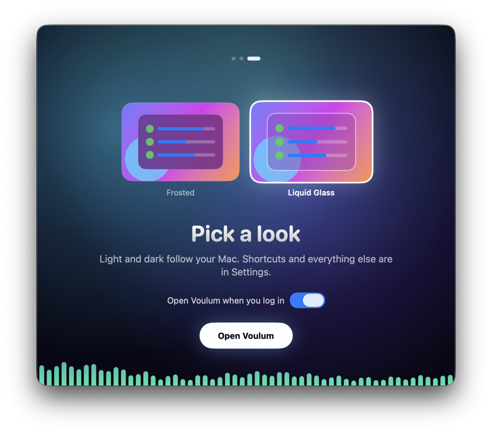
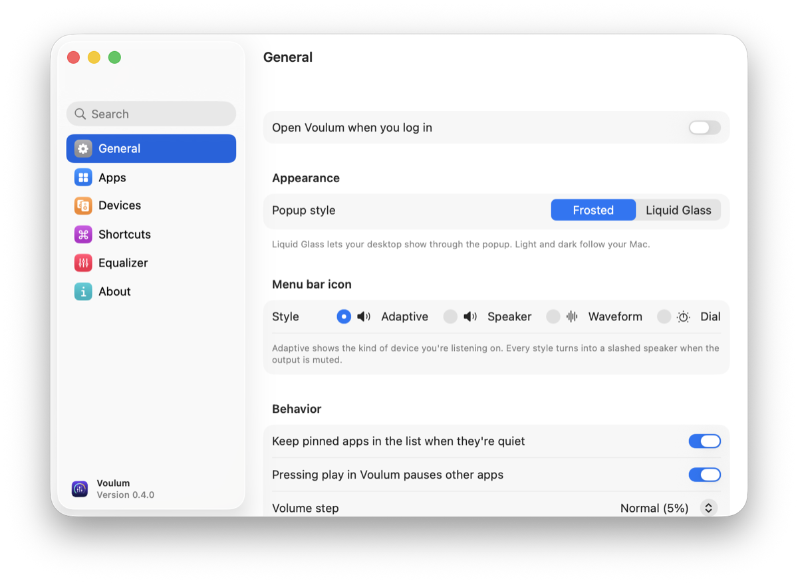
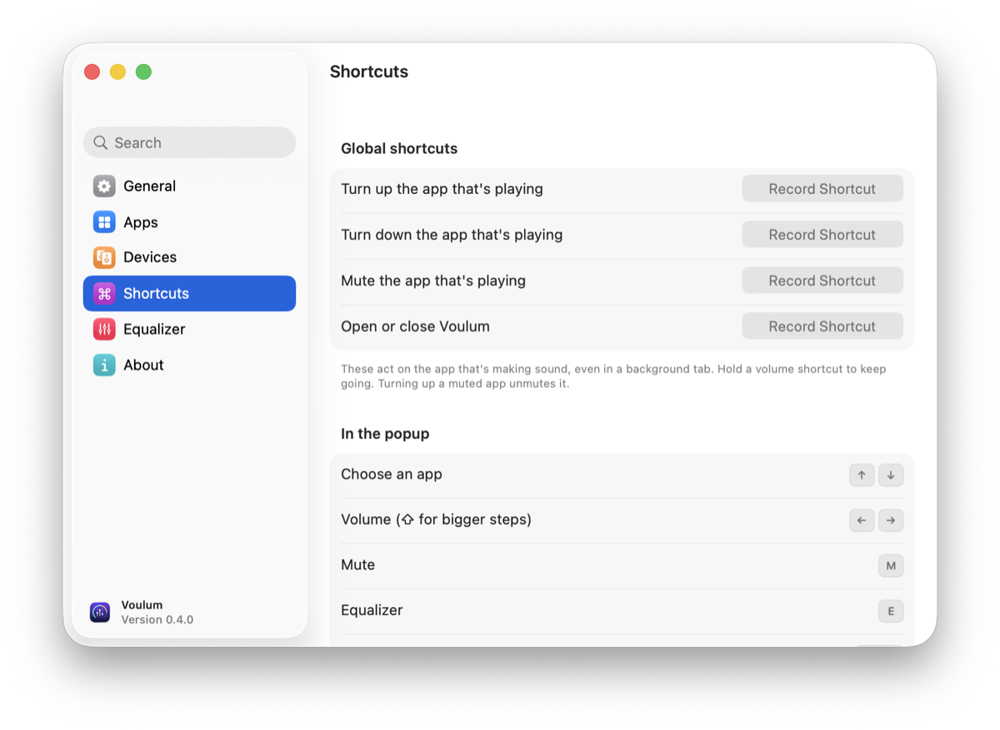

<p align="center">
  
</p>

<h1 align="center">Voulum</h1>

<p align="center">
  <em>Per-app volume, routing and EQ for macOS, from your menu bar.</em>
</p>

<p align="center">
  
</p>

macOS gives you one volume knob for everything. Voulum adds the missing mixer.
It also solves the daily annoyance behind it: **"which of my thirty open windows
is making that sound?"**

Click the menu-bar icon to see every app playing audio. Each app gets a **level
ring** around its icon that moves with its sound, so the noisy one stands out at
a glance.

## What it does

**Per-app volume**
- One slider per app, from mute through 100% to a **4× boost**. The boost zone
  is tinted, and the slider sticks at 100% so it's easy to get back to normal.
- Settings are remembered per app, so Spotify comes back at the level you left it.
- Scroll over a slider to nudge it. Double-click the percentage to reset it.
- **Pin** apps so they stay in the list even when they're quiet. **Ignore** apps
  you never want to see.

**Output routing**
- Send any app to a different output, or to **several outputs at once**. For
  example, music goes to the speakers and the AirPods together.
- If a device disconnects, the app falls back to the system output. It switches
  back by itself when the device returns.
- The system output and input are a click away, each with a volume slider.
- Set a device priority order, and optionally switch to your preferred device
  automatically when it connects.

**Equalizer**
- A 10-band EQ per app that you shape by **dragging the response curve**.
- 20 built-in presets (voice, music, listening), plus presets you save yourself.

**Play / pause and what's playing**
- Pause the app itself, not just its sound. Starting one app can pause the others.
- Browsers show the tab that's making sound, like a YouTube Music track in
  Safari, Chrome, Arc or Flecha.

**Keyboard and automation**
- Global shortcuts for volume up/down, mute and opening the popup. They act on
  the app that's playing.
- Full keyboard control in the popup:
  - ↑↓ select an app; ←→ change its volume
  - M mute · E equalizer · Space play/pause · Return show the app
- A `voulum://` URL scheme for Shortcuts, Raycast or scripts (see below).

**Menu bar**
- The icon follows your output volume and device.
- Choose from a few icon styles in Settings.
- The popup comes in Frosted or, on macOS 26, Liquid Glass. Light and dark
  follow your Mac.

**Languages**
- English, Brazilian Portuguese and Spanish.

## A look around

**Welcome tour.** Three quick steps on first launch: allow audio access, see the
apps Voulum hears, pick a look.

<p align="center">
  
  
  
</p>

**Settings.** A sidebar with search, so any option is a few keystrokes away.

<p align="center">
  
  
</p>

## Install

### Download

1. Download **`Voulum-vX.Y.Z-macos.dmg`** from the
   [latest release](../../releases/latest) and open it.
2. Drag **Voulum.app** onto **Applications**.
3. Open **Voulum**. Look for its icon in your menu bar.

Voulum is signed with a Developer ID and notarized by Apple, so it opens like
any other app. Updates install from inside the app.

Requires **macOS 14.4** or newer.

### Homebrew

```bash
brew install --cask lucianodiisouza/voulum/voulum
```

Update it with `brew upgrade --cask voulum`, or let the app update itself.

<details>
<summary>Installing an older, unsigned release?</summary>

Releases before notarization were ad-hoc signed. macOS refuses to open them
until you clear the quarantine flag:

```bash
xattr -dr com.apple.quarantine /Applications/Voulum.app
```
</details>

## First use

- **Welcome tour.** A short tour asks for audio access, shows the apps it hears
  and lets you pick a look. You can replay it from Settings ▸ General.
- **Audio permission.** The first time you change an app, macOS asks to let
  Voulum capture its audio. That is how per-app volume works under the hood.
  Click **Allow**. You can review it later in **System Settings ▸ Privacy &
  Security**.
- **Settings.** Open them from the popup's footer (⌘,). They cover launch at
  login, icon style, volume step, devices, shortcuts and your EQ presets.
- **Watch the tour again** from Settings ▸ About, or from the terminal:

  ```bash
  open "voulum://settings?tab=about"
  ```

## Automation

| URL | Does |
|-----|------|
| `voulum://volume?app=Spotify&level=40` | set an app to 40% (0–400) |
| `voulum://volume?step=-10` | the playing app, 10 points down |
| `voulum://mute?app=Safari` · `unmute` · `toggle-mute` | mute control |
| `voulum://route?app=Music&device=AirPods,MacBook%20Pro%20Speakers` | route to one or more devices (`system` to reset) |
| `voulum://eq?app=Spotify&preset=Late%20Night` | apply an EQ preset (`&enabled=false` to bypass) |
| `voulum://reset?app=Spotify` | back to defaults |
| `voulum://output?device=AirPods` | switch the system output |
| `voulum://output-volume?level=30` | system output volume |
| `voulum://open` · `close` · `toggle` · `settings` | the popup and Settings window |
| `voulum://settings?tab=equalizer` | a Settings tab (`general`, `apps`, `devices`, `shortcuts`, `equalizer`, `about`) |

`app=` accepts an app name or bundle id. Leave it out to target the app that's
playing.

```bash
open "voulum://volume?app=Spotify&level=40"
```

## FAQ

**Why doesn't every app get a play/pause button?**
macOS has no general "pause that app" command. Voulum drives each app through
its own scripting interface, so only these are supported: Spotify, Apple Music,
TV, VLC, QuickTime Player, and Safari/Chrome/Brave/Edge/Vivaldi/Arc/Opera/Flecha
for audio in a tab.

Browsers also need "Allow JavaScript from Apple Events" switched on in their
Develop/Developer menu to play or pause. Without it Voulum still shows the tab
title. They can't reach a player embedded from another domain.
When that happens, Voulum says so instead of pretending it paused.

Volume, mute, routing and EQ work on every app either way.

**Is it safe? What's the audio permission for?**
Voulum uses Apple's Core Audio "process tap" API to pick up an app's audio and
play it back with your volume, EQ and routing applied. macOS treats that as
audio capture, so it asks for permission. Voulum only plays audio back to your
devices. It records nothing.

Apps you haven't changed are never tapped.

**Does it need a virtual audio driver?**
No. There's no kernel extension or driver to install. Quit Voulum and every app
goes straight back to normal.

## Troubleshooting

**Voulum doesn't see an app, or volume changes do nothing.** Check that Voulum
is on in **System Settings ▸ Privacy & Security ▸ Screen & System Audio
Recording**. To start over and get the permission prompt again:

```bash
tccutil reset All com.voulum.app
```

**Logs.** Voulum logs to the unified log:

```bash
log stream --predicate 'subsystem == "com.voulum.app"' --level info
```

**Start fresh.** Quit Voulum, then clear its saved settings (volumes, presets,
shortcuts):

```bash
defaults delete com.voulum.app
```

## Uninstall

Quit Voulum from the popup, then:

```bash
rm -rf /Applications/Voulum.app
defaults delete com.voulum.app
tccutil reset All com.voulum.app
```

With Homebrew, `brew uninstall --cask --zap voulum` removes the app and its settings.

## Building it yourself

```bash
brew install xcodegen
git clone https://github.com/lucianodiisouza/voulum.git
cd voulum
xcodegen generate
xcodebuild -project Voulum.xcodeproj -scheme Voulum -configuration Debug \
  -derivedDataPath build build
open build/Build/Products/Debug/Voulum.app
```

More in [docs/DEVELOPMENT.md](docs/DEVELOPMENT.md): architecture, the self-test
and how releases are signed.

## License

MIT. See [LICENSE](LICENSE).
